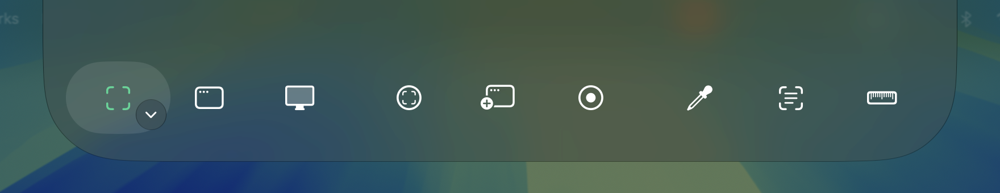
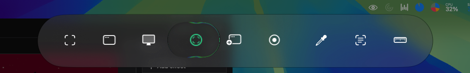
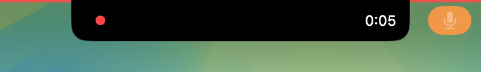

# wadjet

A macOS-native capture tool in the spirit of ShareX, for macOS 26+.

## Why it exists

CleanShot X couldn't upload to my own server.
iShare couldn't capture the cursor during region capture, or hand me the file once the link reached the clipboard.
Its recording never worked for me, either.
I'm building wadjet to fix these frustrations without adding complexity.

## Screenshots







## Status

**v0.0.1. Early, with working Screenshot Tools and simulated Recording and upload flows.**

What works today:

- Freeze Frame on every display, cursor included. Capture a region, window, or screen.
  Window Capture reaches the real window through the Freeze Frame.
- HDR Freeze Frames and HDR Screenshots on HDR displays, with HEIC gain-map output.
- Pick colour, Copy text via Vision OCR, and Measure copy their results to the clipboard.
- Thumbnail toasts and Pin, with floating Screenshots you can move, pan, zoom, and resize.
- A toolbar on every display, integrated with the notch or a fake Dynamic Island, expanding on hover.

Recording controls work, but Recording writes no video file yet, only a thumbnail.
Uploads and GIF conversion are simulated. Destinations, History, and Settings are disabled stubs.

## Where it's heading

- Workflows of ordered Steps for saving, copying, opening, pinning, and uploading each Capture.
- Destinations including Wadjet Servers, cloud storage, and custom `.sxcu` imports from ShareX.
- MP4 and GIF Recording, with pause and an optional trim Step.
- Searchable history across Macs through Wadjet Server listings.
- A self-hostable Wadjet Server for Cloudflare, Docker, and Kubernetes through a Helm chart.

See [DIRECTION.md](DIRECTION.md) for the full picture.

## Build and run

Requires macOS 26+ and Xcode 26 or newer. From the repo root:

```sh
apps/macos/run.sh
```

The script builds, bundles, signs, and opens `apps/macos/build/Wadjet.app`, replacing any running copy.
It uses an Apple Development signing identity when available, or ad-hoc signing otherwise.
`swift test --package-path apps/macos/WadjetKit` runs the UI-free unit tests without building the app.
To build and sign without launching, as CI does:

```sh
WADJET_NO_OPEN=1 apps/macos/run.sh
```

Grant Screen Recording permission in **System Settings > Privacy & Security > Screen & System Audio Recording**.
Then trigger a Tool again.

Hotkeys, fixed for now until Shortcuts are configurable:

- **⌘⇧4** opens Capture region.
- **⌘⇧3** opens Capture screen.
- **⌘⇧5** opens Record region. Press again to stop the Recording.

The remaining Tools are in the eye menu and toolbar. Esc dismisses the Freeze Frame or cancels a countdown.
Esc does not stop a Recording.
See [the macOS app README](apps/macos/README.md#debug-command-channel) for the debug command channel.

## Repo layout

`apps/macos/` contains the Swift macOS app, currently a plain SwiftPM package.
The Wadjet Server will join it under `apps/`; Turborepo tooling arrives with the server.
